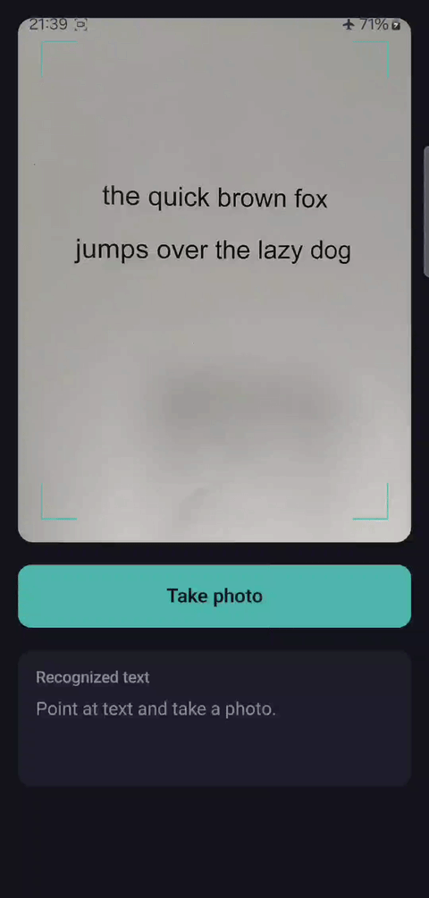

# On-device text recognition on Android

An Android app that reads printed text from the camera, fully offline. Classical OpenCV segmentation finds the characters, and a small CNN trained from scratch on EMNIST Letters classifies them. The model is quantised to int8 and runs through the TensorFlow Lite runtime (now branded LiteRT). There is no network permission and no third-party OCR engine.

Course project for Generative and Deep Learning at the University of Pisa (2025/26), supervised by Davide Bacciu. The full written report is in [`report/gdl_text_recognition_report.pdf`](report/gdl_text_recognition_report.pdf).

ML Kit, Apple Vision or Tesseract will read text better than this does, and the project doesn't try to compete with them. The goal was to own the whole chain on constrained hardware: data preparation, a model under a parameter budget, quantised deployment, camera integration, and measuring an end-to-end error that no single component optimises.

**Stack:** Python 3.11, TensorFlow 2.19.1 / Keras 3.14.1, OpenCV (4.13.0 in Python, 4.11.0 on Android), Kotlin, CameraX 1.5.1, Jetpack Compose, TensorFlow Lite 2.17.0 (LiteRT).

<p align="center">
  
</p>

## Results

| What                                         | Result                                           |
|----------------------------------------------|--------------------------------------------------|
| Classifier accuracy (EMNIST test, float)     | 94.37 % (macro-F1 0.9438)                        |
| Classifier accuracy (int8, via interpreter)  | 94.41 %                                          |
| Model size                                   | 125 KB int8 (443.9 KB float32)                   |
| End-to-end character error rate (CER)        | 0.128 mean, 0.115 median, 26 photos              |
| On-device latency (Galaxy A52s)              | 50 ms median per page, of which model 7.5 ms     |
| Kotlin vs Python glyph preprocessing         | within 1/255, checked on the phone               |

CER by category: geometry (tilt, distance, blur, bent sheet) 0.057, printed fonts 0.121, lighting 0.130, handwriting 0.213. The 26 photos were taken for this project and each one varies one factor, so an error can be traced to a cause. Latency was measured on a fixed 4624×3468 photo (5 warm-up and 20 measured runs) and covers the `transcribe()` call only, without camera capture. On the phone the CV part takes 41.8 ms and the CNN 7.5 ms, so the bottleneck is image processing, not the network.

Two caveats. The CER numbers come from the Python pipeline on the photos, not from running the app over the whole set. And the on-device parity test covers the per-glyph preprocessing and the classifier. It does not cover segmentation (see below).

## How it works

```
camera frame -> rotation correction -> RGBA to BGR
  -> resize to 1000 px width -> grayscale
  -> adaptive threshold (inverse)
  -> line segmentation (horizontal projection)
  -> connected components per character (+ i/j dot merge)
  -> per glyph: pad to square, resize to 28x28, scale to [0,1]
  -> CNN (TensorFlow Lite, float32 in/out) -> argmax -> letter
  -> line grouping, left-to-right ordering, space insertion
```

I classify isolated glyphs instead of training a sequence model (CRNN/CTC). EMNIST gives labelled single characters but no labelled lines, a small CNN trains on a laptop, and every intermediate result (mask, boxes, 28×28 crops) can be inspected, so a wrong output points at the stage that caused it.

The Python preprocessing in `ml/src/preprocess.py` is the reference, and the Kotlin code in `Preprocess.kt` is a transcription of it. An instrumented test pushes fixed glyphs through the Kotlin code on the phone and compares the tensors with the ones Python produced, with a tolerance of one grey level.

## What I learned from the errors

- **Resolution normalisation made the biggest difference.** All thresholds are in pixels. On a ~3500 px wide photo the 31 px adaptive-threshold window fits inside a stroke, so letters hollow out into vertical slivers. Scaling to 1000 px first took the mean CER from 0.90 to 0.14. It never showed up on synthetic renders, which have thin strokes.
- **EMNIST is stored transposed and flipped.** A network trained on it directly gets a normal test score and reads every glyph rotated on real photos. I fixed it with a transpose and flip and checked it visually.
- **The tfds EMNIST test split is broken.** Classes t to z are missing and s is halved (14,800 examples instead of 20,800), so it silently overstates accuracy. I carved validation and test sets from the train split instead and checked that all 26 classes are present.
- **The golden test caught a blur mismatch.** The Kotlin call to Gaussian blur used a different default sigma than Python, which put pixels up to 79 grey levels apart. After fixing that, about 5 levels of difference remained because OpenCV computes its automatic sigma slightly differently on Android. Removing the blur made the port match and lowered CER from 0.14 to 0.128.
- **The golden test also missed a bug.** On the phone, the per-line crop was an OpenCV view into the full image, and `connectedComponentsWithStats` merged letters across rows. NumPy doesn't do this. The test covered the glyph preprocessing but not segmentation, so it stayed green while the app output nonsense. The fix is to clone the crop, and the lesson is that parity tests have to cover the whole pipeline.

The remaining gap between 94 % on EMNIST and 0.128 CER is mostly the wrong number of characters (merged glyphs, speckle), not wrong classification. The most common classifier confusion is l/i, which look almost identical after case merging and downsampling to 28×28.

## Repository layout

```
ml/
  notebooks/     01_data, 02_train, 03_quantize, 04_pipeline
  src/           data.py, model.py, preprocess.py, pipeline.py
  artifacts/     model_int8.tflite, labels, golden vectors, confusion matrix
  test_images/   26 evaluation photos with .gt.txt ground truth
report/          full written report (PDF)
android/         Android Studio project
  app/src/main/java/.../ml/       Preprocess.kt, Recognizer.kt, Pipeline.kt
  app/src/androidTest/            GoldenVectorTest.kt, LatencyTest.kt
```

## Running it

**Model and pipeline.** Python 3.11, on Windows with a plain virtualenv:

```bash
python -m venv .venv
source .venv/bin/activate          # Windows: .venv\Scripts\activate
pip install -r ml/requirements.txt
```

Exact versions are in `ml/requirements.lock.txt`. I only ran this on Windows. Then run the notebooks in `ml/notebooks/` from top to bottom:

1. `01_data`: downloads EMNIST Letters (~536 MB, first run only), fixes the orientation, builds a deterministic 80/10/10 split and applies augmentation to the training part.
2. `02_train`: trains the baseline CNN (113,210 parameters) and a depthwise-separable variant (32,154 parameters, 93.40 %). I kept the baseline because the one point of accuracy was worth more than the speed difference.
3. `03_quantize`: full-integer post-training quantisation, calibrated on ~1,200 training images, with float32 input and output so no scaling is needed on the device. Quantisation cost no accuracy.
4. `04_pipeline`: runs the full photo-to-text pipeline on the 26 test photos, computes CER and exports the golden vectors.

**Android app.** Open `android/` in Android Studio, connect a phone with USB debugging (developed on a Samsung Galaxy A52s, minSdk 26), run the `app` configuration and allow camera access. Point the camera at printed text and tap the capture button; the transcription appears below with copy and share actions.

`GoldenVectorTest` and `LatencyTest` in `androidTest/` run on the device. The EMNIST data is not in the repository; the first notebook downloads it.

## Limitations

The model reads 26 lower-case letters only: no digits, punctuation, capitals or diacritics. It expects a single column of roughly horizontal text and has no perspective correction. The evaluation is 26 photos on one phone, so the differences between categories are descriptive and I make no claims about significance. A full on-device CER run and memory profiling are still to do. The debug APK is 165 MB, almost all of it OpenCV libraries for four ABIs, and peak memory is about 270 MB during repeated transcription.

Possible next steps are perspective rectification, a learned character detector instead of connected components, and EMNIST Balanced with 47 classes.

## Notes

I used an AI coding assistant for code generation and for diagnosing bugs from logs and intermediate images. The design decisions, the evaluation corpus (printing, photographing and handwriting the sheets), all training and device runs, and checking every number in the report were mine. The report has the full disclosure.

OpenCV, TensorFlow Lite and CameraX are Apache-2.0. EMNIST derives from NIST SD19 (research use).


Marcin Czarnecki, M.Sc. Computer Science (AI), University of Pisa, www.linkedin.com/in/marcin-czarnecki-002488309

Released under the MIT License, see `LICENSE`.